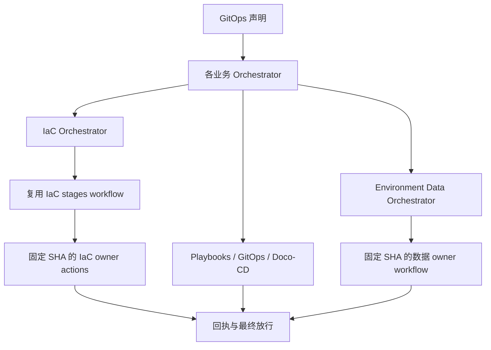

# 流水线入口收敛与重构记录

日期：2026-10-12。仓库：`ai-workspace-infra/platform-ops-toolkit`。

本次把六云 IaC 的兼容入口收敛为 `iac-orchestrator.yml`，迁移调用方后删除 8 个旧 workflow。工作流文件总数从 44 降为 36。服务、数据、发布和测试编排按职责保留；云资源执行仍归 IaC Modules，主机、服务和数据库执行仍归 Playbooks。

本记录区分代码、离线 CI、部署和现场验收。本次没有 dispatch 基础设施、服务部署或数据迁移，也没有操作生产主机、生产数据库或生产 DNS。

## 统一入口

| Actions 显示名 | Workflow 文件 | 职责 |
|---|---|---|
| IaC Orchestrator | `iac-orchestrator.yml` | 六云目标校验、阶段顺序、授权、owner 调用和回执汇总 |
| Open Platform Orchestrator | `open-platform-orchestrator.yml` | 共享 Vault、Observability、IAM 的基础设施与服务协调 |
| Selfhost Orchestrator | `selfhost-orchestrator.yml` | IaC dispatch、SSH/Playbooks/GitOps/Doco-CD 部署、数据 dispatch、验收 |
| Hybrid Orchestrator | `hybrid-orchestrator.yml` | GitOps 多云资源矩阵与跨业务域顺序 |
| Serverless Orchestrator | `serverless-orchestrator.yml` | Serverless 应用、数据库和域名的专用交付 |
| AI Aggregator Orchestrator | `ai-aggregator-v1.yml` | AI Aggregator 声明、节点与服务的协调 |
| Performance Test Orchestrator | `k6-performance-test.yaml` | k6 性能测试运行与结果收集 |
| Daily Snapshot Orchestrator | `daily-main-snapshot.yaml` | 不可变快照、跨仓库构建和 SIT/UAT 交付协调 |
| Environment Data Orchestrator | `environment-data-operations.yml` | 数据操作入口、审批、固定 Playbooks owner 和验收回执 |

除原 IaC master 改名外，已有编排文件的路径保持稳定，只调整显示名。定时触发、发布调用、数据调用和历史回执不会因统一显示名而改名。



## 旧入口替代关系

| 已退役入口 | 替代方式 |
|---|---|
| `iac-pipeline-multi-cloud-master.yaml` | 改名为 `iac-orchestrator.yml`，保留原正向/反向 DAG |
| `gcp-iac-pipeline.yml` | 统一入口选择 GCP 的 reviewed target 或 resource manifest |
| `akamai-cloud-iac.yml` | 统一入口选择 Akamai 的 reviewed target |
| `ucloud-iac.yml` | 统一入口选择 UCloud 的 reviewed target |
| `gcp-oidc-bootstrap.yml` | 统一入口使用 `stage_scope=bootstrap` |
| `iac-pipeline-multi-cloud-landingzone-baseline.yaml` | 统一入口使用 `stage_scope=bootstrap` |
| `iac-pipeline-multi-cloud-account-matrix.yaml` | 统一入口使用 `stage_scope=account` |
| `iac-pipeline-multi-cloud-resources-matrix.yaml` | 统一入口使用 `stage_scope=resources` |
| `gcp-uat-workload-sequence.yml` | 当前多云编排使用 Hybrid；特定 GCP 操作使用明确的 IaC target |

旧 GCP workload sequence 的历史业务域顺序不作为当前 Hybrid 矩阵的隐式兼容规则。当前 GitOps 的 provider、account、workspace 和 existing-host 声明决定目标；不能把旧的全 GCP 假设用于新的多云布局。

这些文件从当前 `.github/workflows` 删除，Git 历史和不可变 release 中仍可回溯。旧操作手册保留历史凭据/state 信息，但已标注旧 workflow 命令退役并链接到本记录。

## IaC 合同与调用方

统一入口的 `action` 为 `check / plan / apply / destroy`，`stage_scope` 为 `all / bootstrap / account / resources`。正向流程是 bootstrap → account → resources；destroy 顺序反转为 resources → account → bootstrap。原 state lock、审批环境和终端回执门禁继续生效。

优先提供明确的 `target_manifest`。共享服务调用方可提供 `resource_manifest`、`cloud_provider` 和 `account`；统一入口使用固定 IaC owner 的输入归一化 action，从 GitOps 中解析唯一 target。缺失、歧义、身份冲突或阶段不支持都会失败。已有显式 `selectors` 仍进入 owner 校验，不被新参数覆盖。

迁移后的调用方包括：

- Selfhost 的 dispatch 脚本：改为 dispatch `iac-orchestrator.yml`，保留关联 ID、子 run/attempt、回执 artifact ID 和 checksum 校验。
- Serverless：直接复用统一 IaC workflow。
- Vault、ZITADEL 和 Open Platform 的三个共享状态：直接调用统一入口，去除 GCP wrapper → matrix → master 的间接链路。
- Vault 的资源编排固定使用 `fbb3100f40ee40d2ac276bffc7b3b6c1a7440b20`；节点访问和访问清理的原 `iac_ref` 默认值保持 `d7e49189a5de9c105a940f1c79abfb3b2b33bbd4`。两条合同分别核验，不随入口改名升级节点执行版本。
- GCP 维护工具的 dispatch 子命令：改为统一入口，要求显式 `--target-manifest`，使用 bootstrap 阶段。凭据准备和 state 身份没有改名。
- Daily Snapshot 的 Selfhost 调用：显式传入 `open_platform_service=none`，避免旧的 `all` 参数覆盖新默认值。

示例只展示 UAT plan 的参数，不代表本次执行了该命令：

```bash
gh workflow run iac-orchestrator.yml --ref main \
  -f action=plan \
  -f environment=uat \
  -f target_manifest=iac/targets/uat-akamai-web-saas.yaml \
  -f stage_scope=resources \
  -f bootstrap_mode=verify
```

`iac-self-check-matrix.yml` 保留为静态 CI：没有部署 action 输入、没有 `workflow_call` 部署入口、没有 OIDC 写权限、没有 Vault 登录或 IaC 编排调用。四个 job 中的 `execute-iac` 只保留拒绝门禁，使固定 owner 的 summary 仍能核验显式 skipped 的执行结果；它不会创建第二条部署路径。

## 共享服务与 none/check

`vault-server.yml`、`observability-server.yml`、`zitadel-server.yml` 继续负责各服务的独立生命周期、恢复和诊断。上层 Open Platform 协调它们，服务 workflow 因此不作为重复副本删除。

| 参数 | 行为 |
|---|---|
| Open Platform `operation=check` | 仅运行请求合同校验，不调度共享 IaC 或服务 |
| Open Platform `target_services=none` | 默认选项；仅校验请求，不调度共享 IaC 或服务 |
| Open Platform `target_services=vault / observability / iam / all` | 显式选择共享服务；原 plan/apply/deploy/upgrade/migrate 边界保留 |
| Selfhost `open_platform_service=none` | 默认跳过旧共享服务主机的 bootstrap 和服务 CD；其它业务域继续按原操作执行 |

Open Platform 的 check/none 不接受部署 tag 或迁移控制。Selfhost 的 none 通过 CMDB 分组过滤 SSH bootstrap 矩阵，排除 `infra_platform`、`open_platform` 主机；不能只在下拉框加选项而继续执行旧服务部署。它只约束旧服务交付，不把独立 IaC 操作改成全局空操作。

## 为什么仍保留这些文件

- `iac-pipeline-multi-cloud-stages.yaml`：内部 reusable workflow，承载独立阶段的 runner、环境和 state 锁，不是第二个用户入口。
- `external-inventory-state.yml`：existing-host inventory 与 Terraform 生命周期不同，不合并进资源创建/销毁路径。
- `aws-oidc-bootstrap.yml`：显式恢复流程，不是普通 plan/apply 的等价入口。
- `iac-akamai-state-preflight.yaml`、`iac-cloudflare-serverless-domains.yaml`：被数据/Serverless 编排引用的专用 owner handoff。
- CI、验收、TLS 维护、诊断、release 状态和清理流水线：具有独立触发与验收条件，未仅按名称相似删除。

历史 Vault/OIDC allowlist 和受控 PROD 回执中的旧 workflow 路径保留用于验证旧运行。Shared bootstrap 角色的源声明增加精确的 `iac-orchestrator.yml@refs/heads/main`，保留原声明，并继续约束 repository、main 和 protected environment；这些源声明本次没有应用到任何 Vault 服务。

GitOps 缺少某共享服务的唯一 `IaCPipelineTargets` 声明时，新入口会阻断；本次没有添加隐式 provider 默认目标，也没有用临时 manifest 绕过合同。

## 五阶段与验证记录

Selfhost 的通用 operation 选单从 18 项收敛为 `plan / infra / deploy / migrate / deploy+migrate / destroy` 六项，默认 `plan`。`deploy+migrate` 明确表示应用部署加数据迁移。`deploy+init` 和 `native-*` 不再作为当前 main 的通用手动选项。初始化等数据操作使用 Environment Data 受控入口；普通 deploy 不隐式授权初始化或迁移，组合流程必须显式选择 deploy+migrate。

历史 native 执行源码与回执合同保留，已有数据 caller 仍只派发不可变 release 中的 Selfhost workflow。精简 main 的选单不改写旧 release 或扩大 PROD 数据权限。

Selfhost 的五个逻辑阶段为 Resolve/Validate → IaC → Deploy → Migrate/Configure → Verify/Report。GitHub Actions 仍显示各业务域矩阵 job；本次没有把它压缩成恰好五个可见 job。

Migrate 继续 dispatch `environment-data-operations.yml`。部署并迁移要求部署/验收完成，DNS 需等待迁移成功。编排门禁还补齐了 existing Agent Proxy 对 Web SaaS 部署/验收结果的检查，阻止上游失败后继续注册。

离线验证覆盖以下行为：

- 旧 workflow 和 active reusable-workflow 引用不存在；新统一入口和共享调用方参数相容。
- IaC 的正向/反向 DAG、固定 owner、终端 evidence gate 和跨 run 回执下载保持一致。
- Static CI 不具备部署路由或 OIDC 写权限。
- Open Platform check/none 不 dispatch；Selfhost none 从示例 CMDB 排除共享主机，保留业务主机。
- workflow gating、脚本引用、owner checkout 和 Toolkit execution ownership scanner。
- 固定 IaC owner 的 32 项 action/合同测试，包括保存 plan 后再 apply、持久资源删除保护、逆向 destroy、state 身份和静态回执负面用例。

合并代码和离线 CI 通过，仅证明入口/合同重构。后续仍需对指定不可变版本执行 SIT/UAT：先确认目标声明与授权，再做 plan，审批后 apply/deploy，最后验证目标主机、回执和应用状态。本次没有执行该现场验收链路。

前序五阶段标注及外部 IaC dispatch 见 [PR #1389](https://github.com/ai-workspace-infra/platform-ops-toolkit/pull/1389)；合约修复和简化说明见 [PR #1391](https://github.com/ai-workspace-infra/platform-ops-toolkit/pull/1391)。本次入口退役、调用方迁移和 Orchestrator 分类见 [PR #1392](https://github.com/ai-workspace-infra/platform-ops-toolkit/pull/1392)。合并状态与 CI 结果以对应 PR 记录为准。
