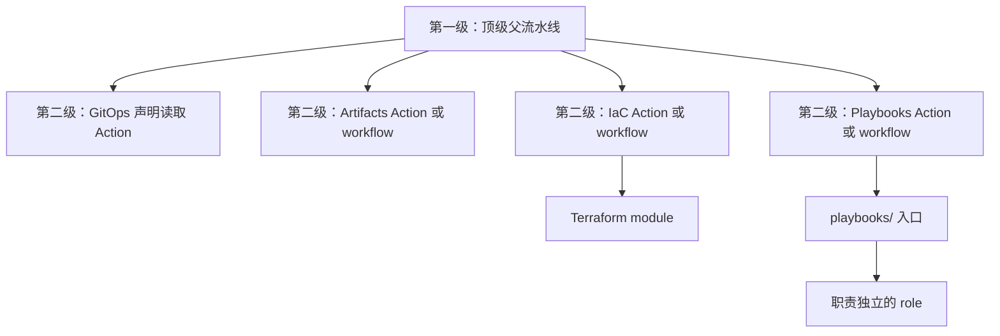

# 流水线职责与两级调用规范

状态：规范框架已定义；具体 owner 接口、流水线重写及目录迁移须分别实施和验证。

本文件由根目录 [AGENTS.md](../AGENTS.md) 引用，适用于本仓全部流水线和共享 Action。

## 1. 仓库职责

| Owner | 职责 |
| --- | --- |
| Platform-Orchestrator | 输入选择、审批与授权、DAG、调用 owner、等待与关联运行、回执校验和最终状态 |
| IaC / iac_modules | 云资源、DNS、State、云事实及权威 CMDB |
| GitOps / gitops | 环境拓扑、资源配置、版本引用、Flux 声明和非敏感配置引用 |
| Artifacts / artifacts | 应用构建、镜像与 Chart 打包、发布及制品元数据 |
| Playbooks / playbooks | 主机、服务、身份、数据库、备份恢复、迁移及健康检查执行 |

按实际副作用判定归属。将执行脚本包装为 Action 不会改变 owner；不得在 Orchestrator 复制执行器或环境声明。

## 2. 两级调用框架

- 第一级保留 daily-main-snapshot.yaml、hybrid-orchestrator.yml、selfhost-orchestrator.yml、iac-orchestrator.yml、serverless-orchestrator.yml。
- 第二级是被父流水线调用的单一职责 Action 或可复用 workflow。第二级 workflow 不得再派发或调用第三层 workflow。
- Action、Terraform module、playbook 与 role 的内部复用不计为 workflow 层级，但不得通过包装隐藏额外 workflow 派发。
- 五个顶级入口之间不得形成逐层派发链。跨入口需要的能力应由共同 owner 接口提供。
- 每个 workflow 的静态 needs 最长链最多 5 个 job，通常 3–5 个；同阶段目标按矩阵并行。保留真实权限、审批、数据和失败依赖。
- workflow YAML 负责 inputs、permissions、environment、concurrency、matrix、needs、uses 和 outputs。复杂逻辑封装到所属 owner；不得新增内嵌 shell/Python 执行器。

### 2.1 Daily 固定候选主链

`daily-main-snapshot.yaml` 固定为五层：声明和 SHA 解析 → 组件 owner 构建矩阵 → 候选门禁 → 可选 UAT owner 派发 → 回执汇总。组件矩阵、制品合同和 UAT 目标来自固定 GitOps 声明；构建和发布由 Artifacts owner 接口触发并返回逐组件回执。

Daily 只生成 `daily-build-*` 的不可变 UAT 候选。默认仅构建，显式选择 UAT 时才允许派发；UAT owner 声明未就绪、目标不匹配或回执缺失时必须失败关闭。PROD 不在该主链创建或部署，必须由独立发布授权消费已经验收的同一 digest/候选事实。

## 3. 声明、版本与调用契约

1. GitOps 是期望配置来源，IaC CMDB 是资源事实来源。禁止按节点、批次、云账号或目录后缀推断专用流程，禁止维护第二套环境配置。
2. 基础仓库 ref 默认 main；每次运行各解析一次完整 SHA，记录并向下游传递同一结果。业务镜像与 Chart 固定不可变版本或 digest。
3. 优先 uses 调用 owner Action。固定 SHA checkout 后可调用本地 composite Action；需要运行时 SHA 的 workflow 使用受控 dispatch、精确关联与回执核验，不在 uses 中伪造动态 ref。
4. 每个接口明确输入 schema、输出 schema、权限、允许的操作、失败语义、幂等性和副作用范围。凭据从受控身份运行时获取，不进入声明和回执。
5. GitOps reader 只读取和校验声明；Artifacts 构建发布；IaC 执行资源操作；Playbooks 执行主机、服务和数据操作。

## 4. Playbooks 配置管理框架

执行入口统一放在 playbooks/；入口负责选择目标、参数校验及 role 编排，一个 role 聚焦一项核心能力。

| 目录 | 目标职责 |
| --- | --- |
| roles/vhosts/ | OS、主机、存储、主机服务及集群引导 |
| roles/containers/ | 容器服务运行配置、生命周期和交付 |
| roles/k8s_helm/ | Kubernetes / Helm 必需的初始化与受控操作 |

roles/docker/ → roles/containers/ 是待实施目录迁移，本文不代表已重命名。Docker/Podman 安装、daemon 和主机权限配置归对应 vhosts role；容器服务由明确参数选择运行时。重命名须同步调用方、role 依赖、文档及检查。

GitOps/Flux 已管理的业务资源不得再由 k8s_helm 维护第二套期望状态。K3s bootstrap 完成身份和 Flux 交接后，业务调谐由 Flux 根据声明推进，通知由 Flux 自身负责。

## 5. 回执与验收

回执至少关联 schema 版本、环境、目标、operation、候选标识、GitOps SHA、owner SHA、CMDB 身份（适用时）、子运行 ID/attempt 和逐目标结果。

成功、失败、预期跳过、未运行、证据缺失分别表达。必需目标失败、缺失或版本不匹配必须失败；不能把 dispatch 接受、CI 成功或 Flux 交接当成业务验收成功。候选构件清单包含组件源 SHA、镜像 digest、Chart 版本和校验摘要；tag 仅作为索引。

## 6. 实施与验证顺序

盘点 caller → 补齐 owner 接口与回执 → owner PR 合入 → 接通 caller → 验证目标和失败传播 → 删除旧路径及深度例外。

至少覆盖空目标、目标不匹配、版本不匹配、owner 失败、部分目标失败、回执缺失及预期跳过。代码验证、部署交付、运行验收分别报告。

本规范不自动授权部署、迁移、云资源/DNS/Vault 变更，也不代表当前保留的五个入口已满足本框架。
